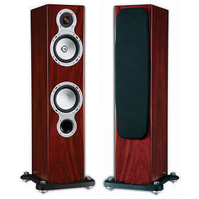
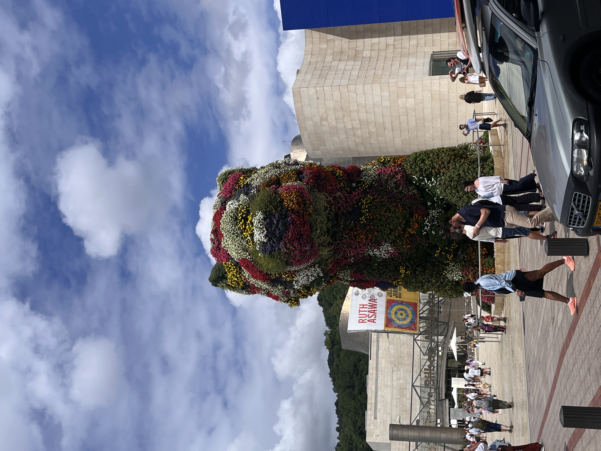

# **My Artistic Autobiography**

<em>A personal journey through art, culture, creativity and the things that shape me.</em>

## **01 - What Art and Culture Mean to Me**

What is art? And what exactly do we mean when we talk about culture? These might sound like simple questions, but the more I think about them, the harder they become to answer. Everyone has their own interpretation, and I don't believe there is a singular definition that works for everybody.

For me, art has to be something that you can admire. It doesn't necessarily have to be beautiful, complicated or insanely impressive. Even something small can be art, as long as there is something about it that makes you stop and appreciate it. It could be a painting, a piece of music, a building, or even something completely else. Art does not have to impress the entire world to mean something to one person.

Culture, on the other hand, is more about how people live. It includes their traditions, languages, history, music, values, and social norms. Culture influences how people behave, what they believe in and how they express themselves. It is something that connects people, even when they have never met eachother.

I think art and culture are closely connected because art often reflects the society in which it is created. Music, architecture, clothing and films can all tell us something about the people who made them. At the same time, art can challenge cultural traditions and encourage people to see things differently.

However, I also believe that art is personal. Something that means a lot to one person might mean absolutely nothing to another. I have experienced this myself, especially when visiting museums. But before getting to that, I want to go back to one of my earliest memories.

---

## **02 - The Sound That Changed Everything**
<!-- THIS IS THE ACTUAL FLOORSTANDER BUT AS A PICTURE FROM THE INTERNET -->
<figure>
    
    <figcaption>My dad's sound system, which introduced me to the impact of high-quality sound.</figcaption>
</figure>

One of my earliest memories takes me back to when I was a little child, playful and full of energy. My dad had bought a new, very expensive sound system and was installing it in our living room. I watched from a distance, but honestly, I didn't really care about what he was doing or why. I had absolutely no idea what I was missing out on.

Once the system was installed, my dad called me downstairs. At first, I really didn't want to go. I couldn't understand why I should care about a bunch of speakers. But as soon as I walked into the living room, my dad put on some music.

I remember it like it was yesterday. He gave me a stack of Michael Jackson CDs and told me to insert one. I asked him how to do it, and he simply told me to figure it out. As a little child, I thought that was a rather rude response. Still, I gave it a try, and it turned out to be surprisingly simple.

My dad told me to play the music and I pressed the button. Suddenly the room was filled with sound. I was shocked by the quality. Of course, because I was a small child and apparently already had an ego to protect, I acted as if it were nothing special. But over time, I began to appreciate it more and more.

Then my dad showed me that I could connect my phone through Bluetooth and stream my own music. I was overjoyed. I could finally listen to my own playlist through those speakers.

Looking back, I find it interesting that one of my earliest experiences with music was not at a concert or in a music lesson, but my own living room. It taught me that the way something is presented can completely change your experience of it. Music had always existed, but that sound system helped me discover just how much of an impact it could have.

---

## **03 - Discovering Creativity at Primary School**

During primary school, I had a teacher whom I will call Petra. She taught us about art through activities such as drawing, painting and sculpting. These lessons gave us the opportunity to create things ourselves rather than simply look at what other people had made.

One project that I remember particularly well involved researching how people in different parts of the world lived. We then had to turn our research into a silhouette painting. I created one large painting divided into four squares. One contained animals and the savannah, another showed a group of people dancing around a campfire, and a third featured skyscrapers and modern infrastructure. In the final square, I tried to bring the different elements together so the result would look like one complete painting rather than four unrelated pictures.

Looking back, I can see how that project connected art and culture. We researched different ways of life and then used art to represent what we had learned. It also showed me that creating something is not just about making it look good. You can also communicate ideas and information through it.

Our school did organise excursions, but we rarely visited museums or attended performances. We usually had one standard excursion each year, so those experiences were limited.

There was, however, one performance which I will never forget: our graduation musical at the end of primary school. The show was a sort of imitation of <em>Got Talent</em>, with students singing, dancing and performing tricks.

I wasn't exactly the first choice for a role though. In fact, I was the last person to receive one after everyone else had already been assigned theirs. Fortunately, I ended up as the advertiser. I would walk onto the stage and promote random products.

I only had to appear twice. The first time went perfectly fine, and people laughed at the jokes. The second time however, I walked onto the stage and immediately heard a parent loudly say, "Oh nee, niet hij weer!"

Of course, I knew the parent was joking and trying to get a laugh from the audience. And it worked.

My role also allowed me to do things nobody else could, such as dumping a container of flour onto a classmate's head to advertise my fictional anti-dandruff shampoo. It might not have been the most prestigious role in the musical, but it certainly gave me something to remember.

Ten out of ten. I would do it again any day.

---

## **04 - Different People, Different Perspectives**

In my family, art can be defined as panoramic views, good wine and a cool summer breeze. My dad loves travelling to Italy, partly because of that exact combination. He seems to appreciate the atmosphere and the experience of being somewhere beautiful.

My mum has a different perspective. She is more interested in the art you can find in museums. Last summer, we visited the Guggenheim Museum in Bilbao, Spain.

<figure class="right">
    
    <figcaption>The Guggenheim Museum in Bilbao, where modern art left me with more questions than answers.</figcaption>
</figure>

I have to admit that I didn't understand much of what I saw inside. There were large sheets of metal arranged in ways I couldn't really make sense of, and rugs hanging from the ceiling. To best describe it, imagine if Aladdin had a fever dream.

<figure class="right">
    
    <figcaption>Some of the exhibits inside the Guggenheim, which looked more like a fever dream than art to me.</figcaption>
</figure>

My mum however, seemed genuinely interested in the exhibits. I couldn't understand what she saw in them, but that is what makes art so interesting: two people can look the same thing and have completely different opinions. I don't think either of us is necessarily wrong. We simple appreciate different things.

---

## 05 - Museums, Films, and Music

I have also visited the Rijksmuseum, the Anne Frank House and the Military Museum in Utrecht (as to what I can recall). I found the Rijksmuseum fairly ordinary. Although its objects have great historical value, their importance to society does not automatically make them valuable to me personally. The Anne Frank House was different. Being able to walk through the small space where Anne Frank hid made history feel much more real.

Films and music have a bigger impact on my everyday life. I enjoy stories about life and death, adventure and fantasy. My favourite film is <em>Interstellar</em>, mainly because of its music, visuals and diverse characters. I also enjoyed <em>Oppenheimer</em>, which kept me interested from beginning to end.

Music can completely change my mood. Fast, loud music gives me energy, while softer music can make me feel sad or help me relax. I often listen to jazz while studying or simply calming down. I rarely attend concerts because of their cost, but I would go more often with friends if tickets were more affordable.

One experience that particularly affected me happened after a film's credits. I once stayed to watch a short film about suicide and domestic abuse. It ended with the following quote:

> "Approach others with empathy and a forgiving spirit, mindful that we are all operating without prior rehearsal."

This made me think differently about people. We cannot always know what someone else is experiencing, so judging them without understanding their situation can be unfair. It showed me that art can communicate important messages and influence how we see the world.

---

# **06 - Creativity and Personal Style**

In my free time, I enjoy programming and making small games that I will probably never upload. I can spend hours solving one problem or creating 3D models for a game, ranging from vehicles and skyscrapers to something as simple as a Band-Aid. I enjoy combining technology with creativity and turning an idea into something that actually works.

Fashion is another form of art to me. Colours, materials and clothing can be combined to express individuality. My own style has changed a lot. I used to grab the nearest jeans, T-shirt and sweater, but nowadays I spend more time deciding what goes together.

I also question why people sometimes buy clothes simply because they are trending. There is nothing wrong with following trends, but I believe it is more interesting to develop your own taste. After all, everyone is different, and we should be able to express that.

---

## **07 - Travel and Looking Ahead**

I have visited a diverse range of countries including Portugal and Czechia, although I cannot recall enough specific details to compare their cultures properly. Still, travelling exposes you to different ways of living, from architecture and food to language and traditions.

I don't actively search for cultural experiences; they usually happen naturally through my hobbies, family or everyday life. I also rarely read books, preferring to experience stories through films and games.

As I get older, I expect my interests in art and culture to change slightly. I don't know exactly how, but I doubt they will become less interesting. Whether I am listening to music, creating a game or visiting somewhere new, there is always something to discover.

Ultimately, art does not have to be beautiful or universally admired. For me, it simply has to be something worth appreciating. Culture is how people live and express themselves, and both remind me that everyone has a different perspective. I don't need to understand or enjoy everything I encounter. Sometimes, it is enough to remain curious and appreciate that other people see things differently.
